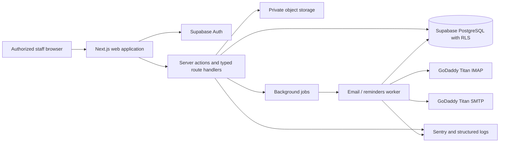

# Technical Requirements Document (TRD)

**Version:** 1.0 working specification  
**Date:** 17 November 2026  
**Architecture principle:** Premium experience, restrained infrastructure.

## 1. Target architecture

Start with a **modular Next.js application**, a Postgres database and a dedicated asynchronous integration worker. Do not start with microservices. Separate code by business capability so APIs and modules can be replaced without a redesign.



## 2. Selected technology and why

| Concern | Default | Engineering constraint |
| --- | --- | --- |
| Web | Next.js App Router, React, TypeScript strict mode | Prefer server-rendered shells; interactive components only where needed |
| Styling | Tailwind CSS + design tokens + shadcn-style accessible primitives | Override *all* radius variants to `0`; no third-party default rounded UI |
| Animation | Motion for React | Transform/opacity where possible; do not animate large blur/backdrop effects on every card |
| Client state | TanStack Query | Cache invalidation by entity key; optimistic updates with rollback |
| Tabular UI | TanStack Table | Server pagination/sorting for larger collections |
| DnD | dnd-kit | Keyboard alternative and server-confirmed persisted order |
| Validation | Zod or equivalent runtime schemas | Validate all untrusted server inputs; derived TypeScript types |
| Data | Supabase PostgreSQL + migrations | Foreign keys, transactions, indexes, RLS and consistent UTC timestamps |
| Auth | Supabase Auth | Invite-only, MFA for privileged users, secure server-side session checks |
| File storage | Private object storage with signed access | Virus scan, authorized downloads, bounded upload sizes |
| Email | Titan IMAP + SMTP adapter | Independent from Google/Microsoft APIs; sync in workers |
| Jobs | Inngest or equivalent durable queue | Retries, idempotency, scheduling and observable failure states |
| Hosting | Vercel (web) + worker-capable hosting as required | Long-running IMAP operations must not depend on short request execution windows |
| Monitoring | Sentry + structured metrics/logs | Remove message bodies, tokens and sensitive fields from telemetry |
| Test | Vitest, Testing Library, Playwright | CI-blocking unit, integration and critical e2e coverage |

Pin current stable versions in `package.json` at implementation; perform compatibility and dependency audits rather than assuming future versions.

## 3. Runtime boundaries

### Client/browser

Page navigation, accessible interactions, status display, local optimistic rendering and formatting. No service-role key, mailbox password, SMTP connection or untrusted document rendering with unrestricted HTML.

### Next.js server

Authentication, authorization, validation, domain services, typed APIs, secure URL generation, report aggregation and background job submission. Require server-side authorization **for every mutation and record read**.

### Background worker

Initial and incremental email synchronization, MIME parsing, scheduled sends, retries, reminder generation, file scanning and reconciliation tasks. Provide per-mailbox locks and rate limits.

### Database

Source of truth for CRM records and job intent; transactional consistency for invoice totals and stage changes. Do not rely on a browser cache as the authoritative store.

## 4. Codebase structure (proposed)

```text
src/
  app/(auth)/sign-in/
  app/(workspace)/overview/
  app/(workspace)/clients/
  app/(workspace)/projects/
  app/(workspace)/pipeline/
  app/(workspace)/tasks/
  app/(workspace)/emails/
  app/(workspace)/templates/
  app/(workspace)/invoices/
  app/(workspace)/reports/
  app/(workspace)/settings/
  components/ui/              # zero-radius accessible primitives
  components/workspace/       # shell, navigation, search, theme
  features/{clients,projects,tasks,pipeline,emails,invoices,...}/
  lib/{auth,db,permissions,validation,logger,errors}/
  styles/tokens.css
  workers/{email-sync,email-send,reminders}/
  tests/{unit,integration,e2e}/
supabase/migrations/
```

## 5. UX and performance budgets

Budgets are **engineering targets** to measure in staging/production, not guarantees:

| Measure | Target | Verification |
| --- | --- | --- |
| Interaction to Next Paint (p75, eligible real users) | <= 200 ms | RUM / performance dashboards |
| Largest Contentful Paint (p75, key pages) | <= 2.5 s | Browser performance telemetry |
| Cumulative Layout Shift (p75) | <= 0.1 | Real browser telemetry |
| UI feedback to ordinary click | immediate visible pressed/loading state | Interaction test |
| Most simple UI transitions | 150-250 ms; reduced-motion alternative | Motion review |
| Core list and search result | first meaningful skeleton immediately, streaming/cached data where possible | Network-throttled QA |
| API availability | Target 99.9% monthly after launch, dependent on provider SLAs | Monitoring |
| Background send | Retry transient failures; avoid double-send by idempotency | Integration test |

Use server-side filtering/pagination for high-volume tables, debounced search, stable cached shells, code splitting, font preloading and image optimization. Avoid adding expensive client libraries to every route.

## 6. Data consistency and event strategy

- Each entity has immutable ID, `created_at`, `updated_at`, and optionally a `version` integer for optimistic concurrency.
- Use transactions for invoice line changes, payments, stage history and related activity writes.
- Write a durable `send_intent` before sending external email. Use an idempotency key; reconcile ambiguous SMTP outcomes rather than blindly retrying.
- Use an outbox/event table when a committed DB change must trigger an email or downstream job reliably.
- Design worker jobs as at-least-once; handlers must be idempotent.
- Email sync deduplicates on account, folder, UID validity and UID; also use Message-ID/normalized message hash carefully for cross-folder matching.
- The UI may optimistically move Kanban cards, but must revert/reconcile on a rejected write.

## 7. Email integration implementation

The Titan connector is a server-side adapter supporting `testConnection`, `listFolders`, `syncIncremental`, `fetchMessage`, `sendMessage`, `appendToSentIfRequired` and `disconnect`. This is an internal interface, not a claim that Titan exposes a modern REST API.

**Verified default GoDaddy Titan settings:** IMAP `imap.secureserver.net:993` with TLS; SMTP `smtpout.secureserver.net:465` with TLS. The account may require third-party access enabled and an app password if Titan 2FA is in use. Test the specific mailbox before declaring a feature supported. Details in file 08.

## 8. Security and privacy engineering requirements

- Enforce authorization on both server boundaries and relevant Postgres RLS policies.
- Secret credentials are never bundled into the client. Encrypt mailbox secrets with a separately managed key, restrict access to mail worker and authorized connection management.
- Lock down authentication redirects, session cookies, CSRF-sensitive mutations and upload/download endpoints.
- Sanitize email HTML and attachments; render remote images blocked by default; restrict dangerous attachment types.
- Maintain audit events for access changes, invoice changes, mailbox settings and privileged exports.
- POPIA controls, third-party processing and incident handling are specified in files 04 and 13.

## 9. Environment plan

- `local`: fake/demo CRM records, isolated test mailbox, no production messages.
- `staging`: independent Supabase project and storage, staging domain, synthetic or authorized test data.
- `production`: isolated secrets/data/mailboxes, strict access, backups and alerting.

Do not point development or automated tests at the production Titan mailbox. Where no safe test mailbox is available, use a protocol-level test server/fixtures and limit live Titan integration testing to controlled manual cases.

## 10. Constraints and non-goals

- No real-time multiplayer editing is needed for V1; near-real-time polling/invalidation is sufficient.
- No mobile native application in V1.
- No public multi-tenant SaaS billing model for external customers.
- Do not invent a Titan webhook/API that has not been validated.
- No guarantee of 100% synchronization while the provider is unavailable; surface freshness and retry state honestly.

## 11. TRD completion checks

Architecture review passes when every P0 PRD requirement maps to a module, API and table; privileged data is denied by default; email send failures are recoverable; invoice arithmetic and audit are transactional; themes meet the global zero-radius constraint; and staging has repeatable migrations, test data, monitoring and rollback procedure.
