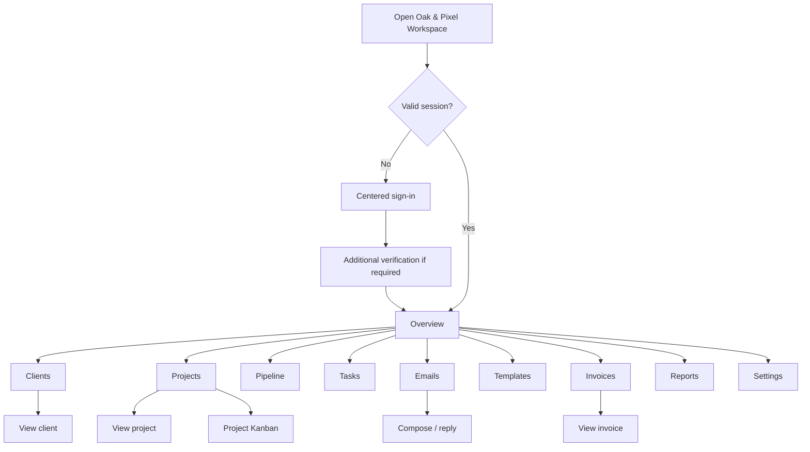
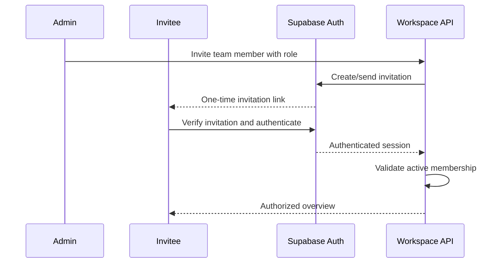
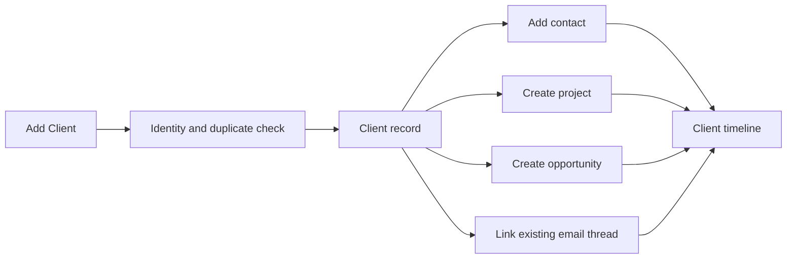
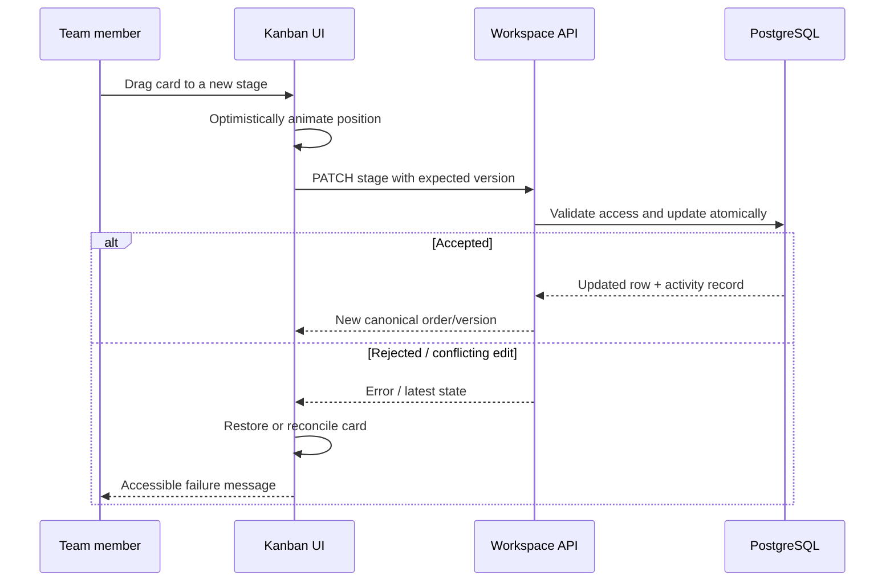
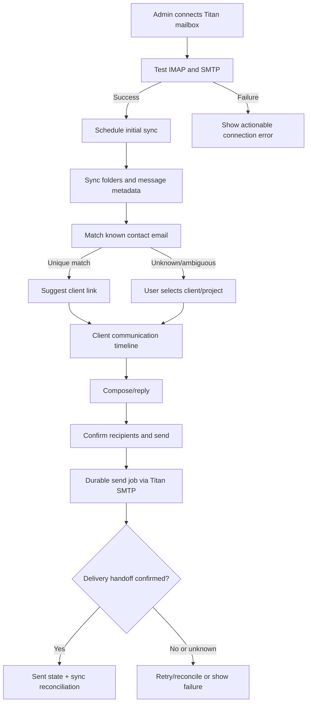
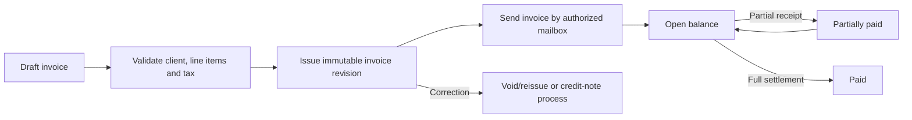

# Application Flow and Information Architecture

**Version:** 1.0 working specification  
**Date:** 17 November 2026

## 1. Application map

The persistent shell contains an expanded/collapsed navigation option, global search, date/context, `New` actions, notifications, dark/light toggle and profile menu. The same shell serves all authenticated routes; a centered sign-in form appears before it.

## 2. Route inventory

| Route | Purpose | Important state |
| --- | --- | --- |
| `/sign-in` | Secure team access | Loading, invalid credentials, MFA, reset link |
| `/overview` | Daily command center | KPI date range and personalized next actions |
| `/clients` | Client directory | Search, filters, selected-client preview |
| `/clients/:id` | Full client record | Overview, Projects, Communication, Invoices, Files, Contacts, Activity |
| `/projects` | Project list | Filters, detail preview, list/Kanban toggle |
| `/projects/board` | All-project Kanban | Status columns, drag & drop, keyboard move |
| `/projects/:id` | Project detail | Overview, Tasks, Files, Communication, Notes |
| `/pipeline` | Deal Kanban | Lead through Won/Lost, forecast controls |
| `/tasks` | Cross-project task management | Task list and task inspector |
| `/emails` | Mail workspace | Inbox, Sent, Drafts, threads, filters, connection health |
| `/templates` | Template library | Category, list, preview, editor |
| `/invoices` | Invoice directory | Summary, filters, statuses, preview |
| `/invoices/:id` | In-app invoice record | Overview, Payments, Activity, Related; PDF secondary |
| `/reports` | Metrics and exports | Date range, definitions and access-based filters |
| `/settings` | Organization and configuration | Team, roles, service settings, email, preferences |

Route names are proposed and may be localized; record identifiers must be opaque UUIDs in APIs, not trusted client names.

## 3. First-time sign-in and provisioning

Rules: no public self-sign-up; expired/revoked invitations fail safely; a suspended member cannot use old sessions for privileged actions. The centered login design must use internal-workspace wording instead of implying a shipped client portal.

## 4. Client intake and context flow

Client list -> select row -> preview -> `View client` -> tabbed detailed record. Every tab retains the same client ID. `Send Email` preselects the client's primary contact but asks the user to confirm recipients and sender mailbox.

## 5. Opportunity and delivery flow

- Lead -> Qualified -> Proposal -> Negotiation -> Won or Lost.
- A Won deal is recorded in history and counted separately from **open** pipeline value.
- `Create project from win` copies approved client/service/scope and links the opportunity. It does not silently generate an invoice or send email.
- Project states: Backlog -> To Do -> In Progress -> In Review -> Completed, with optional On Hold and Canceled states handled explicitly in list/details.
- Task states: To Do -> In Progress -> In Review -> Done, plus Blocked; a task can have assignee, due date and priority.

## 6. Titan mail flow

A queued or SMTP-accepted message is not a promise of inbox delivery. Display `Queued`, `Sending`, `Sent` (provider accepted), `Needs attention`, and `Failed` states accurately.

## 7. Invoice flow

The `View Invoice` route is a rich CRM detail page with summary, item rows, payment history, activity and notes. Downloading a printable PDF is a secondary action.

## 8. Common screen states

All main routes must have consistent treatment for `initial loading`, `content loaded`, `empty`, `no search result`, `permission denied`, `server error`, `offline`, `background syncing`, `saving` and `saved`. Avoid layout shifts when moving between these states. Skeletons use rectangular shapes; do not show an empty area indefinitely.

## 9. Navigation and small-screen rules

- Desktop: expanded sidebar and persistent content shell.
- Tablet: sidebar can collapse into a **square-edged** rail; content stacks without losing filters.
- Mobile: list views show essential columns and detail links; Kanban becomes horizontal scroll or an accessible grouped list.
- Support deep links to client/project/invoice IDs, breadcrumbs and browser back/forward.
- Preserve table filters and pagination in URL query parameters when practical.

## 10. Search behavior

Global search groups results by Clients, Projects, Contacts, Opportunities and Emails (subject to permission). Show matching type, concise secondary context and keyboard navigation. Search returns only authorized results; email results must not leak message subjects or excerpts from private mailboxes.
