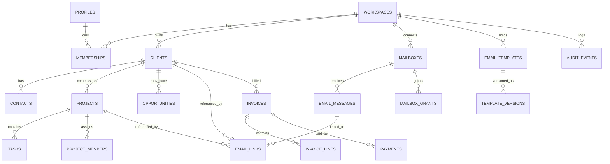

# Backend Schema and Data Model

**Version:** 1.0 working specification  
**Date:** 17 November 2026  
**Database:** Supabase PostgreSQL, migrations as code

## 1. Model principles

- One production Oak & Pixel workspace at launch. Include `workspace_id` on business records to enforce explicit scope and preserve future options; **this is not an invitation to build multi-tenant SaaS features**.
- Primary keys: UUID. Timestamps: `timestamptz` in UTC. Money: `numeric(14,2)` in ZAR (never float). Percentages: explicit numeric precision. Email addresses: normalized for matching, original preserved for display.
- Include `created_at`, `updated_at`, `created_by` where applicable, and `version` where concurrent updates matter.
- Index foreign keys, common date/status searches and `workspace_id` combinations. Avoid arbitrary cascade deletion of invoices, payments, messages or audit events.
- Audit-sensitive entities use append-only histories or controlled adjustment records.
- Public IDs in URLs are opaque; uniqueness is scoped to a workspace where appropriate.

## 2. Entity overview



## 3. Core identity and CRM tables

| Table | Key fields | Important rules |
| --- | --- | --- |
| `workspaces` | `id`, `name`, `slug`, `timezone`, `default_currency`, `created_at` | Single approved workspace initially; default timezone `Africa/Johannesburg`, currency `ZAR` |
| `profiles` | `id` (= auth user ID), `display_name`, `email`, `avatar_key`, `created_at` | No sensitive auth secrets stored here |
| `memberships` | `id`, `workspace_id`, `user_id`, `role`, `state`, `joined_at` | Unique `(workspace_id,user_id)`; active/invited/suspended |
| `clients` | `id`, `workspace_id`, `name`, `legal_name`, `industry`, `status`, `owner_id`, `primary_service_id`, `notes_summary`, timestamps, `version` | Soft archive; normalized-name duplicate warning, not hard uniqueness on ordinary names |
| `contacts` | `id`, `client_id`, `full_name`, `job_title`, `email`, `phone`, `is_primary`, `status` | At most one primary per client via partial unique index; contacts are **not** auth users |
| `services` | `id`, `workspace_id`, `name`, `description`, `active` | E.g., Website & CMS, Website Redesign, SEO, Brand & Website, Multimedia |
| `notes` | `id`, `workspace_id`, `client_id?`, `project_id?`, `invoice_id?`, `body`, `created_by` | Check exactly one valid parent, or use typed `entity_type/entity_id` with strong validation |
| `activity_events` | `id`, `workspace_id`, `entity_type`, `entity_id`, `actor_id?`, `event_type`, `safe_summary`, `created_at` | Timelines; not authoritative finance ledger |

## 4. Sales and delivery tables

| Table | Key fields | Important rules |
| --- | --- | --- |
| `opportunities` | `id`, `workspace_id`, `client_id?`, `title`, `service_id?`, `amount`, `stage`, `probability`, `expected_close`, `owner_id`, `source`, `version` | Money positive or zero; closed/won separated from open pipeline |
| `opportunity_stage_history` | `id`, `opportunity_id`, `from_stage`, `to_stage`, `actor_id`, `changed_at`, `reason?` | Append-only |
| `projects` | `id`, `workspace_id`, `client_id`, `opportunity_id?`, `name`, `description`, `service_id?`, `stage`, `status`, `owner_id`, `start_date`, `due_date`, `progress_percent`, `sort_rank`, `version` | Progress 0..100, stage transition audited; `client_id` required |
| `project_members` | `project_id`, `user_id`, `project_role` | Compound unique key; drives contributor access |
| `tasks` | `id`, `project_id`, `title`, `description`, `assignee_id?`, `priority`, `status`, `due_date`, `sort_rank`, `completed_at?`, `version` | `completed_at` when status Done; audit changes |
| `task_comments` | `id`, `task_id`, `author_id`, `body`, `created_at`, `updated_at` | Access inherits task/project permissions |
| `documents` | `id`, `workspace_id`, `client_id?`, `project_id?`, `invoice_id?`, `private_storage_key`, `file_name`, `mime_type`, `size_bytes`, `uploaded_by`, `scan_status` | Only privately stored; safe signed access; attachment virus status |

## 5. Mail tables

| Table | Key fields | Important rules |
| --- | --- | --- |
| `mailboxes` | `id`, `workspace_id`, `address`, `provider='godaddy_titan'`, `credential_secret_ref`, `state`, `last_sync_at`, `last_error_code?` | Credential reference only, not plaintext; dedicated access control |
| `mailbox_grants` | `mailbox_id`, `user_id`, `permission` | `read`, `compose`, `manage`, controlled per mailbox |
| `mail_folders` | `id`, `mailbox_id`, `provider_path`, `special_use?`, `uid_validity?`, `last_uid?` | Server folder names can vary; verify special-use mapping |
| `email_threads` | `id`, `workspace_id`, `normalized_subject?`, `last_message_at` | Thread association through headers, not subject alone |
| `email_messages` | `id`, `mailbox_id`, `folder_id?`, `thread_id?`, `provider_uid?`, `uid_validity?`, `message_id_header?`, `in_reply_to?`, `references_header?`, `direction`, `from_address`, `subject`, `text_body?`, `safe_html_body?`, `received_at`, `sent_at?`, `sync_state` | Unique `(mailbox_id,folder_id,uid_validity,provider_uid)` where assigned; never use headers as sole unique key |
| `email_recipients` | `id`, `message_id`, `kind`, `display_name?`, `email_normalized` | `to`, `cc`, `bcc`; restrict visibility of BCC |
| `email_attachments` | `id`, `message_id`, `file_name`, `mime_type`, `size_bytes`, `storage_key?`, `scan_state` | Download on-demand; private storage and file scanning |
| `email_links` | `id`, `message_id`, `client_id?`, `project_id?`, `link_source`, `confirmed_by?` | Validate linked project belongs to client; one client link, optional project link per message by current policy |
| `mail_send_jobs` | `id`, `mailbox_id`, `client_message_key`, `draft_id?`, `payload_ref`, `status`, `attempts`, `last_error`, `smtp_accepted_at?`, `scheduled_at?` | Unique client send key; reconcile unknown SMTP outcome before retry |
| `mail_sync_jobs` | `id`, `mailbox_id`, `folder_id?`, `cursor?`, `started_at`, `ended_at`, `status`, `error_class?` | One active sync per mailbox/folder where lock required |

**Important:** Folders, messages and sync cursors are provider-specific. Never assume Titan supports push webhooks, IMAP QRESYNC or special-use folder attributes before testing.

## 6. Templates and billing

| Table | Key fields | Important rules |
| --- | --- | --- |
| `email_templates` | `id`, `workspace_id`, `name`, `category`, `active`, `created_by`, `updated_at` | Soft archive rather than deleting referenced templates |
| `template_versions` | `id`, `template_id`, `version_no`, `subject`, `html_body`, `text_body`, `variable_schema`, `created_by` | Immutable versions to reproduce sent communication |
| `invoices` | `id`, `workspace_id`, `invoice_number`, `client_id`, `project_id?`, `status`, `issue_date`, `due_date`, `currency`, `subtotal`, `tax_total`, `grand_total`, `issued_revision`, `version` | Unique `(workspace_id,invoice_number)`; amounts server-calculated; issued snapshots/adjustments |
| `invoice_lines` | `id`, `invoice_id`, `description`, `quantity`, `unit_price`, `tax_rate`, `position`, `line_subtotal`, `line_tax`, `line_total` | Decimal math with documented rounding policy |
| `payments` | `id`, `invoice_id`, `amount`, `currency`, `received_at`, `reference`, `method`, `recorded_by`, `voided_at?` | Positive amount, duplicates flagged; reversing entry rather than hidden deletion |
| `invoice_events` | `id`, `invoice_id`, `event_type`, `safe_details`, `actor_id?`, `created_at` | Issue, send, payment, void, correction |
| `user_preferences` | `user_id`, `workspace_id`, `theme`, `sidebar_state`, `timezone_override?` | Theme `dark`/`light`/`system`; per-user scope |
| `audit_events` | `id`, `workspace_id`, `actor_id?`, `action`, `entity_type`, `entity_id`, `request_id`, `metadata_redacted`, `created_at` | Append-only for ordinary operators; access controlled |

## 7. Example validation constraints

```sql
-- Illustrative fragments for design review, NOT a complete production migration.
ALTER TABLE projects
  ADD CONSTRAINT project_progress_range
  CHECK (progress_percent BETWEEN 0 AND 100);

ALTER TABLE invoice_lines
  ADD CONSTRAINT invoice_quantity_positive CHECK (quantity > 0);

ALTER TABLE payments
  ADD CONSTRAINT payment_positive CHECK (amount > 0);

CREATE UNIQUE INDEX contacts_one_primary_per_client
  ON contacts (client_id) WHERE is_primary = true AND status = 'active';

CREATE UNIQUE INDEX invoices_workspace_number_unique
  ON invoices (workspace_id, invoice_number);
```

Do not use a simple invoice `updated_at` to rewrite legally meaningful issued line items silently; issue a revision/credit workflow. The invoice tax rate is stored **per issued line**, never recalculated from today's configured default.

## 8. Indexing, access and retention

Indexes: `(workspace_id,status,updated_at)` on clients; `(client_id,stage)` on projects; `(project_id,status,sort_rank)` on tasks; `(workspace_id,stage,expected_close)` on opportunities; `(mailbox_id,received_at DESC)` on messages; `(invoice_id,received_at)` on payments; `(workspace_id,issue_date)` on invoices; sender/recipient normalized email indexes for matching.

RLS: role/workspace access for CRM tables, project membership constraints for contributors, explicit mailbox grants for mail data, finance scopes for invoices. Never expose a view that bypasses underlying policies without conscious authorization.

Retention: do not hardcode an arbitrary legal deletion deadline for invoices/audit/email. Policy is drafted in file 13 and approved by the owner/Information Officer before implementation.

## 9. Migration requirements

- Maintain incremental, reviewed SQL migrations in version control.
- Seed demo workspace with **fictional agency-only records**, never production emails or fake mining data.
- Verify rollback strategy: application rollback is possible; database migrations need forward-compatible expand/contract practices.
- Add DB checks, RLS and trigger tests to CI before deploying migration.
