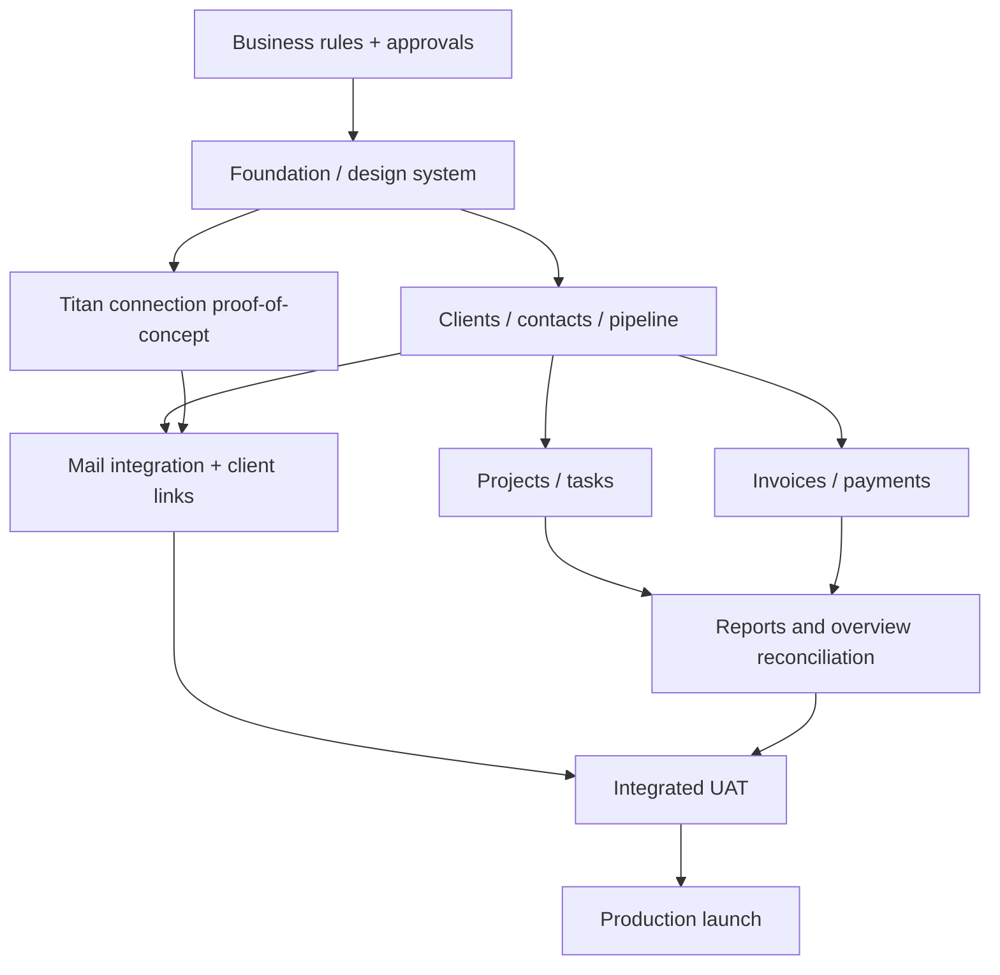

# Implementation Roadmap and Delivery Plan

**Version:** 1.0 working specification  
**Date:** 17 November 2026  
**Principle:** Build small, connected vertical slices. Do not build every visual screen with fake buttons and call it finished.

## 1. Delivery strategy

The design concepts already cover the major screens. Development should now begin with the shared system and complete user journeys, not another round of disconnected page mockups. Each stage requires its data model, permissions, UI, loading/error states and automated tests.

## 2. Phases and exit criteria

### Phase 0 - Confirm business rules and visual authority

**Outputs:** owner-reviewed file 14, component inventory, official domain/name, access-role policy, mail visibility policy, VAT/billing choices, approved initial brand tokens.

**Exit:** no blocking ambiguity on who logs in, who sees emails, what 'paid' means or whether client portal access is V1.

### Phase 1 - Foundation and design system

**Build:** Next.js/TypeScript base, strict lint/test pipelines, Tailwind token layer, accessible hard-edged components, layouts, global navigation, full dark/light modes, authentication, invite-only membership, RLS scaffolding, telemetry.

**Exit:** login -> overview shell works; both themes pass 0px border-radius and keyboard testing; unauthorized users cannot access protected routes.

### Phase 2 - Core CRM and pipeline

**Build:** clients, contacts, client detail, services catalogue, opportunity stages/history, owner/role checks, activities, initial dashboard aggregates, client and pipeline search.

**Exit:** create client -> add contact -> create/qualify deal -> Won -> create project works without duplicate input or permission leaks.

### Phase 3 - Projects and tasks

**Build:** projects list/detail, project status Kanban, tasks/assignees/due dates, simple comments, drag-drop rollback, activity feeds, responsive layouts.

**Exit:** staff can track a real website project end-to-end and recover safely from failed/conflicting status saves.

### Phase 4 - Titan email and templates

**Build:** secure Titan connect, account testing, mailbox grants, IMAP sync, folder mapping, message read/compose/reply/forward, Sent reconciliation, client/project linking, email templates and draft state.

**Exit:** a controlled real Titan account can receive and send; exact-once logical send behavior and permissions tested. This is a **high-risk phase**; begin a narrow Titan connectivity proof-of-concept in parallel with Phase 1 to uncover provider restrictions early.

### Phase 5 - Invoicing and reports

**Build:** invoice drafts, tax and line calculation, issue number/version snapshot, PDF export, send from permitted mailbox, payment recording, overview/report metrics and exports.

**Exit:** totals, partial payment, paid/overdue state, client history and dashboard agree in all tested examples.

### Phase 6 - Hardening and launch

**Build:** visual/accessibility polish, performance tuning, full audit review, staging test, monitoring, backup restore, production deployment, live Titan acceptance, owner training.

**Exit:** file 09 release gates and file 10 operations checks signed off.

## 3. Workstream dependencies

## 4. Backlog conventions

Every implementation ticket should include: linked PRD `FR-*`, route/component/table/API, explicit authorization requirement, acceptance scenario, accessibility requirement, loading/error behavior, both-theme styling and hard-edge QA. Estimate and assign tickets only after the owner approves scope.

## 5. Definition of done

A feature is done only when:

- It works against real persisted data, not only a static mockup.
- Authorized roles can use it and unauthorized roles cannot.
- Input validation, errors, empty states, loading states and retries are implemented.
- It is keyboard accessible and responsive.
- It renders correctly in light and dark themes with **no rounded edges**.
- It has meaningful unit/integration/e2e coverage as appropriate.
- Its events/metrics update the connected CRM pages correctly.
- Logs/monitoring show failures without leaking confidential details.

## 6. Explicit anti-scope-creep rules

- Do not expand the CRM into a general ERP, payroll system or website-builder platform.
- Do not build a client portal merely because the sign-in mockup contains the words `Client Portal`.
- Do not add native mobile apps or multi-tenant billing without evidence of demand.
- Do not automate proposals/contracts without approved legal text and business rules.
- Do not add AI features to compensate for unclear workflows.
- Do not build elaborate chart animations ahead of secure email and financial correctness.

## 7. Owner decision gates

| Gate | Required approval |
| --- | --- |
| G0 | Product name, V1 boundary, roles, email policy and core brand tokens |
| G1 | Sign-in, shell, navigation, dark/light visual quality, strict zero-radius |
| G2 | Clients/pipeline/projects flow with accurate data ownership |
| G3 | Titan test send and receive, privacy and sender authorization |
| G4 | Invoice math/wording, tax and payment policy, report definitions |
| G5 | Security, UAT, backup, operations, production launch |

## 8. Success after launch

Track task completion without duplicated records, daily active staff use, email send error rate, mail sync freshness, invoice reconciliation errors, support requests, p75 interaction performance and client/project visibility. Prioritize fixes from real usage before expanding the feature backlog.
